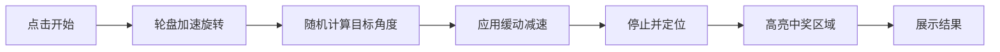

## 1. 产品概述
四等分概率轮盘抽奖程序 - 一个视觉效果精美的转盘抽奖应用，使用 PNG 图片作为奖品展示，每个区域等概率（25%），适用于活动抽奖、互动娱乐等场景。

## 2. 核心功能

### 2.1 功能模块
1. **主页面**: 轮盘展示区、控制按钮、结果展示
2. **动画系统**: 转盘旋转动画、缓动效果、音效反馈

### 2.2 页面详情
| 页面名称 | 模块名称 | 功能描述 |
|-----------|-------------|---------------------|
| 主页面 | 轮盘展示区 | 圆形四等分轮盘，每扇区显示一张 PNG 图片，支持旋转动画 |
| 主页面 | 控制中心 | 开始按钮、重置按钮、当前状态显示 |
| 主页面 | 结果展示 | 抽奖结果高亮显示、历史记录 |

## 3. 核心流程
用户点击"开始"按钮 → 轮盘开始旋转（带缓动效果） → 逐渐减速停止 → 高亮显示中奖区域 → 展示中奖结果

## 4. 用户界面设计
### 4.1 设计风格
- **主色调**: 深色背景 + 金色/霓虹色装饰线条，营造高端抽奖氛围
- **按钮风格**: 立体渐变按钮，带发光效果和悬停动画
- **字体**: 使用 Google Fonts 的特色字体（如 Orbitron 或 ZCOOL KuaiLe）
- **布局**: 居中对齐，卡片式设计，突出轮盘主体
- **视觉元素**: 光晕效果、粒子特效、金属质感边框

### 4.2 页面设计概述
| 页面名称 | 模块名称 | UI 元素 |
|-----------|-------------|-------------|
| 主页面 | 轮盘容器 | Canvas 绘制的圆形轮盘，四等分扇形，每区显示 PNG 图片，中心指针 |
| 主页面 | 控制面板 | 大型发光"开始"按钮，禁用状态管理，点击反馈动画 |
| 主页面 | 结果弹窗 | 模态框显示中奖图片，庆祝动画（彩带/星星），关闭按钮 |

### 4.3 响应式设计
- 桌面端优先：轮盘尺寸 500x500px，居中显示
- 移动端适配：轮盘自适应屏幕宽度（最大 90vw），触摸优化
- 支持横竖屏切换

### 4.4 动画与交互
- **旋转动画**: CSS transform + requestAnimationFrame 实现平滑旋转
- **缓动函数**: 自定义 easeOutQuart 缓动，模拟真实物理减速
- **微交互**: 按钮悬停放大、点击波纹、轮盘呼吸光效
- **结果展示**: 中奖区域闪烁、缩放弹出、粒子爆炸效果
