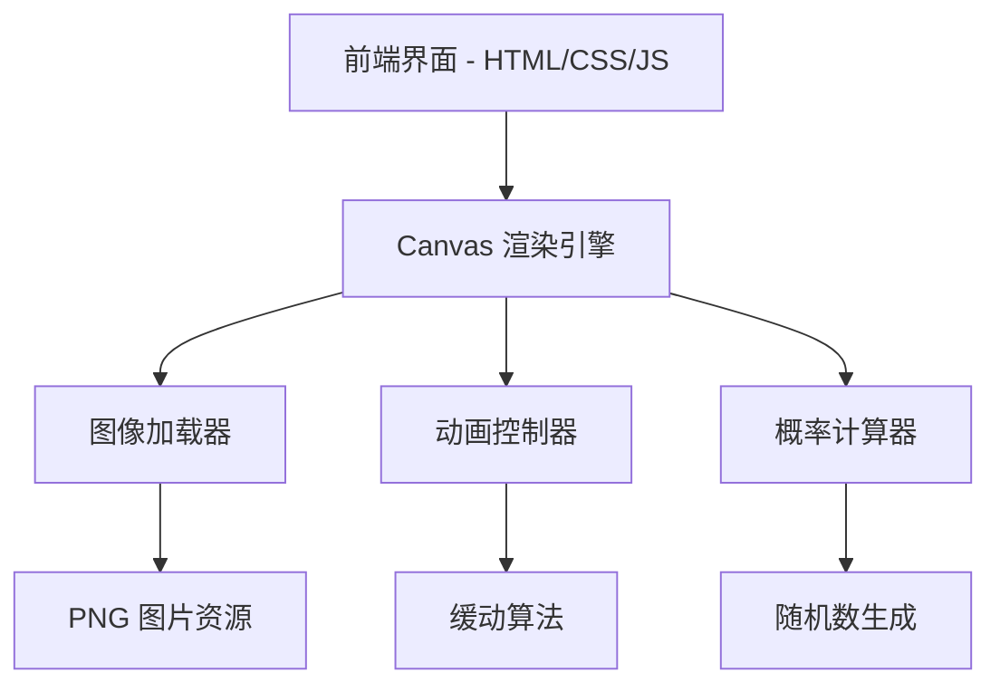

## 1. 架构设计


## 2. 技术选型
- **前端框架**: 原生 HTML5 + CSS3 + Vanilla JavaScript（轻量级单页应用）
- **渲染技术**: Canvas API（高性能图形绘制）
- **构建工具**: 无需构建工具，直接运行
- **动画库**: 原生 requestAnimationFrame + CSS Transitions
- **图像处理**: Canvas drawImage API
- **字体**: Google Fonts (Orbitron + Noto Sans SC)

## 3. 路由定义
单页面应用，无需路由配置

## 4. 核心模块说明

### 4.1 WheelRenderer 类
- 职责: Canvas 轮盘绘制
- 方法:
  - `drawWheel()`: 绘制四等分扇形
  - `drawImages()`: 在各扇区绘制 PNG 图片
  - `drawPointer()`: 绘制中心指针
  - `rotate(angle)`: 旋转变换

### 4.2 SpinController 类
- 职责: 控制旋转逻辑
- 方法:
  - `startSpin()`: 触发旋转
  - `calculateResult()`: 计算中奖区域（基于最终角度）
  - `easeOut(t)`: 缓动函数

### 4.3 ImageLoader 类
- 职责: 异步加载 PNG 图片
- 方法:
  - `loadImages(paths)`: 批量加载图片数组
  - `onProgress(callback)`: 加载进度回调

### 4.4 ProbabilityEngine 类
- 职责: 概率计算
- 方法:
  - `getRandomAngle()`: 返回随机目标角度（确保等概率 25%）

## 5. 数据结构
```javascript
// 配置数据
const config = {
  images: ['春-壁纸.png', '夏-壁纸.png', '秋-壁纸.png', '冬-壁纸.png'], // 可替换为任意4张PNG
  segments: 4,
  probability: [0.25, 0.25, 0.25, 0.25],
  spinDuration: 5000, // ms
  minRotations: 5, // 最少旋转圈数
  maxRotations: 8 // 最多旋转圈数
}

// 结果数据
interface SpinResult {
  winningIndex: number; // 中奖索引 (0-3)
  winningImage: string; // 中奖图片路径
  finalAngle: number; // 最终停止角度
  timestamp: number;
}
```

## 6. 项目文件结构
```
/
├── index.html          # 主页面
├── css/
│   └── style.css       # 样式文件
├── js/
│   ├── main.js         # 入口文件
│   ├── wheel.js        # 轮盘渲染引擎
│   ├── spin.js         # 旋转控制器
│   └── utils.js        # 工具函数
└── assets/             # PNG 图片资源目录（使用现有图片）
```

## 7. 性能优化策略
- 图片预加载：页面初始化时异步加载所有 PNG
- Canvas 离屏渲染：使用 OffscreenCanvas 提升性能
- 动画帧优化：使用 requestAnimationFrame 保证流畅度
- 防抖处理：防止连续快速点击
