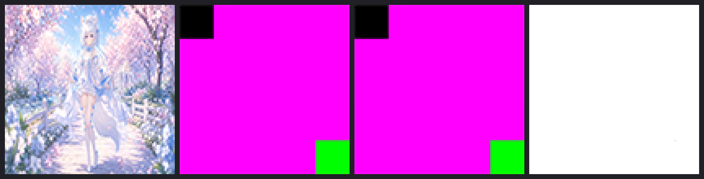

# PSD Pilot v2.1 — 最终证据 Gate

**仓库**：`https://github.com/Gay-wushuang/520live`
**基线 commit**：`b8ad051a101010cb0e47f78acfc91b7dc5e1c831`
**证据/脚本 commit**：`63b772f11045bce7d7b451bc3193405bba7877ec`
**报告 commit**：本文件所在提交（`docs(ui-audit): PSD Pilot v2.1 最终证据 Gate 报告`）
**验收对象**：`ui-audit/psd/pilot/CardWheel-Editable-v2.psd`
— 23,579,934 bytes，SHA256 `7583EEEFF1BC29796C42EA822532553BA45EF7D24115E378193696A6182D198A`
**验收环境**：Windows + Adobe Photoshop **25.11.0**（COM / ExtendScript，真实进程；`E:\Adode\Ps\Adobe Photoshop 2024\Photoshop.exe`）
**最终 Gate**：`PSD_PILOT_ACCEPTED`（v2.1 实测复验；判定依据见 §9）

---

## 0. 为什么 v2 的「已通过」不成立（先更正，再给证据）

本工单要求修复的正是 v2 的三处证据缺口。复核结论如下（原文均可对照上一版报告）：

| # | v2 的说法 | 实际情况 | v2.1 的处理 |
|---|---|---|---|
| 1 | `PASS SO-FULL-RES :: 见后续 replaceContents 验证` | 脚本里是 `expect('SO-FULL-RES', true, ...)`——**恒真硬编码**，从未读取内嵌源像素尺寸 | 删除该行；改为对四个 Smart Object 逐个 `placedLayerEditContents`，实测内嵌源 `宽×高@ppi`，不符即 FAIL（§2） |
| 2 | 「替换图片不破坏其他组件」= `REPLACE-NO-STRUCTURE-CHANGE 47→47` | 只比较了**图层数量**，没有比较几何与像素。实测：替换图缺少 72dpi 时，Photoshop 会把 104×104 的卡图层**重置成 300×300**，v2 的检查完全发现不了 | 增加边界不变、内嵌源尺寸、全页逐像素比对（§3/§4） |
| 3 | 「20/20 PASS」+ 声称有 COM 调用程序 | `.jsx` 末尾无条件返回 `'ok'`，断言失败也不会让调用方失败；COM 调用程序**未入库** | 脚本改为返回 `PSD_PILOT_V21:PASS\|FAIL`；新增 `run-phaseC-acceptance.ps1`，任何失败/异常/缺证据 → 非零退出（§5） |

> 本节即「删除 `SO-FULL-RES` 硬编码 PASS」的落实记录：该断言在 v2.1 脚本中已不存在。

---

## 1. 约束遵守核对

| 约束 | 结果 | 证据 |
|---|---|---|
| 不修改 `src/**` | ✅ | `git diff --stat -- src` 为空 |
| 不重建/覆盖正式交付 PSD | ✅ | 验收只操作临时副本；runner 前后各算一次 SHA256，均为 `7583EE…198A` |
| 不修改原截图基线 | ✅ | `ui-audit/screenshots/**`、`ui-audit/manifest.json` 无变更 |
| 不重新设计旧 UI | ✅ | 仅验证既有交付件，不改视觉设计 |
| 不增加无关验证项目 | ✅ | 新增断言全部服务于工单 1–4；文字/形状编辑沿用 v2 既有项目 |
| 不用无条件 PASS 替代实测 | ✅ | 45 项必需检查 + 25 项像素核验 + 4 条负向自检（§5） |

---

## 2. 缺口 1 — 四季 Smart Object 内嵌源像素尺寸（实测）

脚本：`pilot/intermediate/pilot-phaseC-acceptance.jsx` → `measureSmartObject()`
做法：对每个 SO 执行 `placedLayerEditContents` 打开内嵌源 → 读 `width/height/resolution` → 采样 3 点像素 → 关闭内嵌文档（不保存）→ 断言回到宿主文档。

| 季节 | 图层名 | 显示边界（文档坐标） | 显示尺寸 | 内嵌源尺寸 | 分辨率 | 内嵌源文档名 | 内嵌源中心像素 |
|---|---|---|---|---|---|---|---|
| Spring | `Card image / Spring / Smart Object` | `596,307,700,411` | 104×104 | **1672×941** | 72 ppi | `图层 0.psb` | `218,213,234` |
| Summer | `Card image / Summer / Smart Object` | `726,307,830,411` | 104×104 | **1672×941** | 72 ppi | `图层 01.psb` | `204,217,250` |
| Autumn | `Card image / Autumn / Smart Object` | `596,417,700,521` | 104×104 | **1672×941** | 72 ppi | `图层 02.psb` | `204,183,202` |
| Winter | `Card image / Winter / Smart Object` | `726,417,830,521` | 104×104 | **1672×941** | 72 ppi | `图层 03.psb` | `214,207,233` |

- **结论**：四个内嵌源均为 **1672×941 @72ppi**，与 `ui-audit/design-source/assets/*-积分卡.png` 完全一致 → 属于非破坏性缩放（显示 104×104），不是把卡图降采样后嵌入。
- **断言**：`SO-DIM:Spring|Summer|Autumn|Winter`、`SO-DISPLAY-SIZE`、`SO-SAMPLES-BASELINE` 共 6 项，任一不符即 FAIL。
- 日志原文（`acceptance.log`）：
  ```
  PASS SO-DIM:Spring :: 1672x941 @72ppi doc=图层 0.psb
  PASS SO-DIM:Summer :: 1672x941 @72ppi doc=图层 01.psb
  PASS SO-DIM:Autumn :: 1672x941 @72ppi doc=图层 02.psb
  PASS SO-DIM:Winter :: 1672x941 @72ppi doc=图层 03.psb
  PASS SO-DISPLAY-SIZE :: Spring=104x104 Summer=104x104 Autumn=104x104 Winter=104x104
  ```

---

## 3. 缺口 2 — 春季卡图替换：替换前后图 + 局部像素证据

- 替换素材：`pilot/intermediate/card-spring-marker.png`（`make-spring-marker.mjs` 生成）
  **1672×941 @72dpi**，品红底 `#FF00FF`、左上 1/5 黑块、右下 1/5 绿块——三色互不接近，且角落色可验证未被裁切/翻转。
- 替换方式：`placedLayerReplaceContents`（Photoshop 原生 Smart Object 内容替换）。
- 替换后对象仍是 `SMARTOBJECT`，显示边界 **`596,307,700,411` 未变**，内嵌源 **1672×941 @72ppi**，中心像素 `218,213,234 → 255,0,255`，左上 `0,0,0`、右下 `0,255,0`。
- 导出：替换前 `v21-01-open.png`、替换后 `v21-02-post-replace.png`（均 1440×900）。
- 逐像素核验（`verify-pixel-diff-v21.mjs`）：

| 指标 | 实测值 |
|---|---|
| 全页变化像素 | **10,816** |
| 春季卡矩形内变化 | **10,816 / 10,816 = 100%**（104×104） |
| 春季卡矩形**外**变化 | **0** |
| 矩形内平均绝对差 | **197.28 / 255** |
| 矩形内最大通道差 | **255** |
| 变化包围盒 | `596,307 → 700,411`（恰为卡图矩形） |
| 其余三季卡图变化 | Summer **0**、Autumn **0**、Winter **0** |

- 证据图：
  - `acceptance-v21/diff-map-replace.png`（整页差异热图：仅春季卡处为白色，其余全黑）
  - `acceptance-v21/local-pixel-evidence.png`（春季卡 4× 放大，从左到右：**替换前 → 替换后 → 重开 → 差异**）



> 结论：修改**真实作用在像素上**，且只影响目标卡图区域——不是「描述符改成功」这类假通过。

---

## 4. 缺口 3 — 保存 / 重开持久性 + 其他卡图、非目标区域、图层结构

流程：替换 → 另存 `CardWheel-v2.1-accepted.psd` → 关闭 → 重新打开。

| 检查 | 实测 |
|---|---|
| 重开后整页像素 | **changed=0，max=0，mean=0**（与保存前导出逐像素完全一致，1,296,000 像素） |
| 重开后春季卡内嵌源 | **1672×941 @72ppi**，中心 `255,0,255`、左上 `0,0,0`、右下 `0,255,0` |
| 其余三季内嵌源 | Summer/Autumn/Winter 尺寸与 3 个采样点**与基线完全一致**（`OTHER-SO-CONTENT-STABLE`） |
| 卡图合成结果 | 重开后春季卡区域均值 `235,11,235`（品红），替换前 `197,192,218` |
| 图层结构 | 47 层「名称\|类型\|可见性」有序快照：baseline = afterReplace = afterReopen = afterEdit = afterEditReopen |
| 数量 | text=14、SmartObject=4、Shape=20、total=47（五次快照一致） |

**非目标区域**（同一次重开比对）：
- 春季卡矩形外：0 像素变化。
- 其余三季卡矩形：0 像素变化。
- 标题/按钮区域：此阶段尚未编辑，0 像素变化。

随后再做文字/形状编辑（独立阶段，避免把文字重排差异混入替换证据）：

| 检查 | 实测 |
|---|---|
| 编辑阶段变化像素 | 14,543，包围盒 `568,71 → 877,810`，**全部落在**标题带 + 两个按钮矩形内（外溢 0） |
| 编辑阶段四季卡图 | 全部 0 变化（含被替换的春季卡） |
| 形状改色取样 | `30,204,131`×4（目标绿 `12,200,120` 在 92% 不透明度下与底色的合成值） |
| 再次保存→重开（文字持久性） | 标题 `积分卡转盘V2` 仍在；差异 1,764 像素、max **19/255**，仅落在被编辑的文字字形区域，其余 0 |
| 编辑重开后春季卡 | 仍为品红标记图（均值 `235,11,235`），卡内像素变化 **0** |

---

## 5. 缺口 4 — 任何失败/异常/缺证据都必须变成可检测的失败

### 5.1 脚本侧（`pilot-phaseC-acceptance.jsx`）
- 所有断言经 `expect(label, cond, detail)` 收集；
- 结尾 `finalize()` 统计 `failures` 与 **`missing`（REQUIRED 里没跑到的检查项）**，写入 `acceptance-result.json`；
- 返回值只有两种：`PSD_PILOT_V21:PASS` / `PSD_PILOT_V21:FAIL`；
- 顶层 `try/catch/finally`：任何 ExtendScript 异常都会记录为 `SCRIPT-EXCEPTION` 失败并继续收尾（不会静默跳过）。

### 5.2 COM 调用程序（`run-phaseC-acceptance.ps1`）
判定条件（任一不满足 → `exit 1`）：
1. `DoJavaScriptFile` 抛异常 → `DOJAVASCRIPT-EXCEPTION`；
2. 脚本返回值 ≠ `PSD_PILOT_V21:PASS`；
3. `acceptance-result.json` 的 `result` ≠ `PASS`，或 `failures` 非空；
4. **45 个必需检查项**有任何缺失或 `ok=false`；
5. `exports` 里任何证据文件不存在或过小（PSD < 1 MB / PNG < 100 KB）；
6. 像素核验脚本退出码非 0 或 `pixel-diff-report.json` 结果 ≠ `PASS`；
7. 交付 PSD 的 SHA256 与运行前不一致；
环境失败（连不上 Photoshop）→ `exit 2`。

### 5.3 负向自检（`acceptance-v21/negative-controls.log`）

| 用例 | 期望 | 实测 |
|---|---|---|
| [0] 真实证据 + `-ValidateOnly` | exit 0 | **exit 0**（ACCEPTANCE PASS） |
| [1] 篡改 `acceptance-result.json`：`result=FAIL`、`PS-OPEN=false` | exit 1 | **exit 1** + `FAIL RESULT: FAIL` / `FAIL CHECK-NOT-OK: PS-OPEN` |
| [2] `exports.reopened` 指向不存在的文件 | exit 1 | **exit 1** + `FAIL MISSING-EVIDENCE: reopened` |
| [3] 把 `exports.open` 换成「替换后图」（差异应为 0） | exit 1 | **exit 1** + `FAIL SPRING-REGION-CHANGED :: changedPct=0%` |

此外，v2.1 开发过程中真实触发过一次失败并被正确拦截：
`FAIL SPRING-SO-BOUNDS-UNCHANGED :: before=596,307,700,411 after=498,209,798,509` → runner `exit 1`。
这正是删除硬编码后应当出现的行为（v2 的 47→47 检查不会发现它）。

---

## 6. 本轮新增的真实发现（如实记录）

1. **「替换 Smart Object 内容」按物理尺寸保持**：替换图必须与内嵌源同分辨率（72dpi）。若替换图无 DPI（Photoshop 按 25ppi 处理），图层会放大 `72/25≈2.88` 倍（104×104 → 300×300），且该变化会持久化到保存后的文件。v2 完全未覆盖此风险。
2. **另存 PSD 会对嵌入内容做一次性归一化**：本标记图绿色块 R 通道 `0→1`（399 像素）；保存后再次导出与重开渲染**完全一致**（0 差异）。因此「替换后」证据图在**保存之后**导出，代表真正落盘的状态。
3. **被编辑文字在保存/重开后存在抗锯齿级差异**：1,764 像素、max 19/255，仅限标题与按钮字形区域；卡图与其余区域 0 差异。已作为独立断言 `EDIT-REOPEN-DELTA-BOUNDED` 记录，而非掩盖。
4. **形状改色仍只能用** `contentLayer/ordinal/targetEnum` + `putObject('to','solidColorLayer',…)`；旧的 `Prpr/solidColor` 形式静默无效（沿用 v2 结论，本次仍生效）。

---

## 7. 残余问题（还原度层面，不构成可编辑性缺陷；沿用 v2）

1. 字体替代：NotoSansSC 缺失，使用 `MicrosoftYaHei`，字形度量与设计稿有偏差。
2. 渐变停靠点/角度为近似值，未逐点还原 Figma 渐变节点。
3. Figma 的投影/内阴影/描边未重建为 Photoshop 图层样式。
4. 网格背景以 1px 矢量矩形近似。
5. `build-psd-v2.mjs` 产出的中间 PSD 需要一次文字重排（已固化在 `pilot-to-smart-objects.jsx` 中）。

---

## 8. 复现步骤

```bash
# 0) 生成替换用标记图（1672x941@72dpi）
node ui-audit/psd/pilot/intermediate/make-spring-marker.mjs \
  ui-audit/psd/pilot/intermediate/card-spring-marker.png

# 1) Photoshop 实测验收（真实 COM 进程；脚本 + 像素核验一步到底）
pwsh -NoProfile -ExecutionPolicy Bypass \
  -File ui-audit/psd/pilot/intermediate/run-phaseC-acceptance.ps1
#    → exit 0 = 全部通过；1 = 有断言失败/缺证据；2 = 环境失败

# 2) 只复核既有证据（不启动 Photoshop）
pwsh -NoProfile -ExecutionPolicy Bypass \
  -File ui-audit/psd/pilot/intermediate/run-phaseC-acceptance.ps1 -ValidateOnly

# 3) 单独跑像素核验
node ui-audit/psd/pilot/intermediate/verify-pixel-diff-v21.mjs \
  --workdir=ui-audit/psd/pilot/intermediate/acceptance-v21

# 4) 结构验证（v2 既有）
node ui-audit/psd/pilot/intermediate/validate-psd-v2.mjs \
  "ui-audit/psd/pilot/CardWheel-Editable-v2.psd" --expect-so=4 \
  --out="ui-audit/psd/pilot/validation-v2.json"
```

> 运行前若 `acceptance-v21/` 不存在，runner 会自行创建；`*.psd` 为可重建的大体积中间件，已在 `acceptance-v21/.gitignore` 中排除，其哈希见 §10。

---

## 9. Gate 判定

| 判定项 | 结果 |
|---|---|
| Photoshop 实测检查 | **45 / 45 PASS**（`acceptance.log`，failures=0，missingRequired=0） |
| 逐像素核验 | **25 / 25 PASS**（`pixel-diff-report.json`） |
| 负向自检 | **4 / 4 符合预期**（3 条按预期失败、1 条按预期通过） |
| 交付 PSD 完整性 | SHA256 前后一致（`7583EE…198A`），未被改动 |
| 三处证据缺口 | 全部补齐：内嵌源尺寸实测、替换前后像素证据、保存重开持久性 + 结构/非目标区域 |

> **`PSD_PILOT_ACCEPTED`**

v2 报告中的 `PSD_PILOT_ACCEPTED` 结论在**补齐证据后**依然成立，但依据已被替换为本报告中可复算的 45+25 项实测断言与逐像素数据；v2 的 `SO-FULL-RES`、`20/20`、`47→47 即无破坏` 三处不再作为依据。

---

## 10. 交付物清单与哈希

目录：`ui-audit/psd/pilot/intermediate/acceptance-v21/`

| 文件 | 字节 | SHA256 |
|---|---|---|
| `acceptance.log` | 4,221 | `EA28241FF8AC2EE08DD7B2C1AC1E54DA8648D2436BF342B6E61DA45A2F84DB78` |
| `acceptance-result.json` | 20,716 | `FE6C430B62DED12837BD75E38ED0513215A76887AA19119FC84C71B6431ADDBC` |
| `runner.log` | 2,857 | `1C83C3138AD2FCC3666D89561B1E7F507E8C874F07A2432ABE09D4B7BEA54374` |
| `pixel-diff-report.json` | 10,008 | `B8C74DC2F305D28A16D3B9564466643743EA197807AD0B9FA85F8ED56E279613` |
| `negative-controls.log` | 1,163 | `421B09CDB358EC7CFE407A7BB895923BF38612B71EAEEBF91E98C5B259663AA7` |
| `v21-01-open.png` | 3,896,918 | `4B94C8FA862514792A479C2430BE1CE8E2B5A497AFBD216FF48E9E98C54324EB` |
| `v21-02-post-replace.png` | 3,893,631 | `191AC166D2F407B7721E05C034AEAB9382C1DCFA0EC80A183D8674C16B92D223` |
| `v21-03-reopened.png` | 3,893,631 | `F2FDC6303B71B3399CE928F5294908DD141D9039148B4929888444FFA75E4435` |
| `v21-04-edited.png` | 3,893,630 | `757BB5CF9E427A6C498A57932A164F05BADD7D6741126067A4AB7A8C5598176E` |
| `v21-05-edited-reopened.png` | 3,893,630 | `041F3A985BBE52035E7EDA34C5D160136C7F5FB1B9037AED1BDFE9C8EDE04C69` |
| `local-pixel-evidence.png` | 58,680 | `F5FC2F26E31CB06CA59DBB1DEF4635F2FC91D4E7DED2D2019E7E2CFCC5CF8C3C` |
| `diff-map-replace.png` | 4,274 | `72E1447A87810B7FE5A86B538A8517A03063446833BE571CBD6A420580215C95` |
| `CardWheel-v2.1-accepted.psd`（未入库） | 18,702,665 | `722B6C28D4B76ECCAC7D28DCA1D0CAABBF93EC62EF81E55378F17D54E17F355B` |
| `CardWheel-v2.1-edited.psd`（未入库） | 18,721,331 | `67BDA30A77298145BC9542628FC3E6361D4824A5405E18415D3DE52CD3B5AD54` |

替换素材：`ui-audit/psd/pilot/intermediate/card-spring-marker.png`
— 8,923 bytes，SHA256 `DFD69F36164F556287161671E607141100A147F1FABDEF4C576AD8880A664042`

脚本：
- `pilot-phaseC-acceptance.jsx`（v2.1，重写）
- `run-phaseC-acceptance.ps1`（新增，COM 调用程序）
- `verify-pixel-diff-v21.mjs`（新增，逐像素证据核验）
- `make-spring-marker.mjs`（新增，标记图生成）
